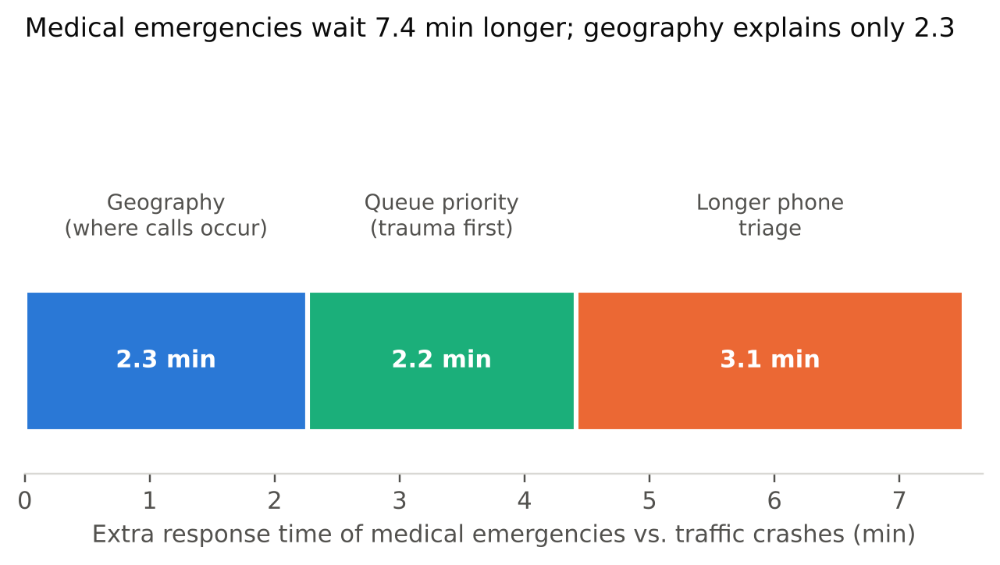
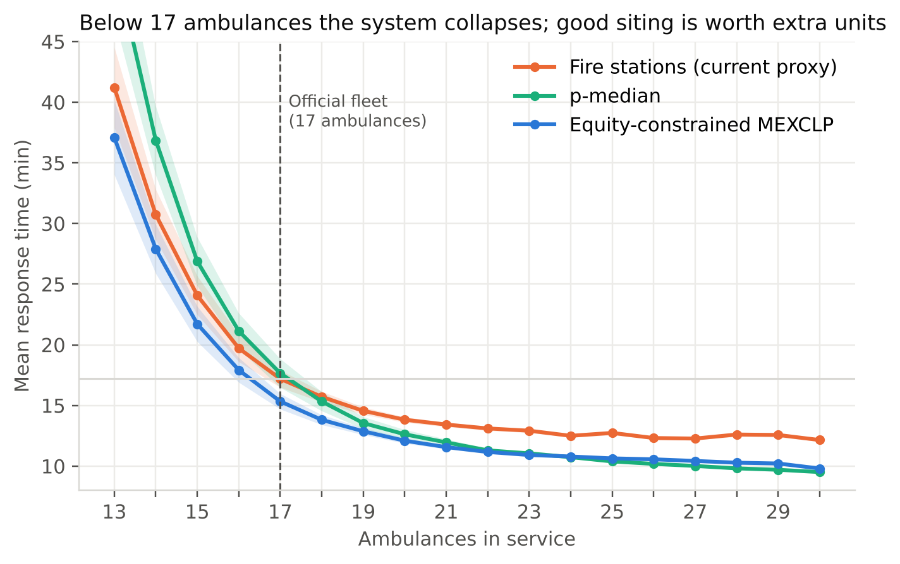

# GeoSalud — ¿Ubicación o flota? Ambulancias en Medellín

**Gemelo digital del programa público de atención prehospitalaria (APH) de Medellín para decidir dónde ubicar las ambulancias, cuántas hacen falta y qué tanto pesa el tiempo que pasan retenidas en las clínicas.**

> *English summary.* We build a calibrated discrete-event simulation of Medellín's public
> EMS (17 ambulances) using open data: 170,737 geocoded traffic crashes (2014–2021) and
> 103,346 dispatched prehospital cases (2018–2022), a time-dependent road network and the
> city's own response-time dashboard. Medical emergencies wait ~7 min longer than crashes;
> geography explains only ~2 min of that gap. An equity-constrained MEXCLP relocation cuts
> mean response time by ~1.9 min (≈ adding more than one ambulance) and improves 20 of 21
> districts, but reducing hospital handover time is the largest single lever.

> ⚠️ **Estado: resultados preliminares.** Los tiempos de los corregimientos se recalculan con
> la red vial metropolitana (ver *Limitaciones*).

## Resultados principales

| | Actual (aprox.: bases en estaciones de bomberos) | Propuesta (MEXCLP equitativo) |
| --- | --- | --- |
| Tiempo medio de respuesta | 17,1 min | 15,3 min |
| Percentil 90 | 25,7 min | 23,2 min |
| Accidentes de tránsito | 13,9 min | 12,3 min |
| Emergencias médicas | 21,3 min | 19,1 min |
| Llamadas atendidas en ≤ 15 min | 68 % | 75 % |

Simulación con la flota oficial de 17 ambulancias; 20 réplicas de 30 días con demanda **fuera de muestra** (2020–2021). El modelo reproduce el tablero oficial de 2026 (13,7 min en accidentes; 20,4 min en emergencias médicas) y el 6,7 % de casos *SinRecurso* de 2022.



- **La brecha no es geográfica.** Las emergencias médicas esperan unos 7 minutos más que los accidentes. Que ocurran en zonas más lejanas explica 2,3 minutos; la prioridad de los accidentes en la cola, 2,2; y una regulación telefónica más larga, 3,1.
- **El sistema está al borde.** Con 15 ambulancias el promedio sube a 24 minutos; con 13, a 41.
- **Reubicar vale más que una ambulancia nueva.** El K-Means del proyecto original *empeora* el servicio (20,2 min), porque dispersa la flota en 17 sitios cuando el sistema está ocupado el 58 % del tiempo.
- **La palanca más grande está en las clínicas.** Bajar la entrega del paciente de 145 a 90 minutos ahorra 3,7 minutos, más que agregar 3 ambulancias. Junto con la reubicación, el promedio llega a 11,7 minutos (−32 %).
- **Validación externa.** La distribución por comuna de los casos sin ambulancia disponible que predice el modelo coincide con los casos *SinRecurso* reales de 2022 (Spearman ρ = 0,91), un dato que no se usó para calibrar.



## Método

1. **Demanda** (`demanda.py`): grilla de 300 m. Los accidentes se ubican por coordenada, un registro por incidente. Las emergencias médicas se reparten dentro de su barrio. Para construir se usan los datos de 2014–2019 y para evaluar los de 2020–2021.
2. **Tiempos de viaje** (`tiempos.py`): grafo dirigido de OpenStreetMap con velocidades por tipo de vía, ajustadas por hora con Google Traffic (2017–2020). Hay cuatro franjas horarias y las distancias se calculan con Dijkstra.
3. **Simulación** (`simulacion.py`): eventos discretos con llegadas Poisson por hora, regulación, cola con prioridad para el trauma, viaje, escena, traslado a la IPS receptora real y regreso a la base.
4. **Calibración** (`calibracion.py`): búsqueda en grilla del tiempo de entrega en la IPS, la velocidad y la regulación médica contra tres objetivos observados.
5. **Estrategias** (`estrategias.py`): bomberos (operación actual aproximada), K-Means ponderado, p-mediana, MEXCLP (Daskin, 1983), MEXCLP con cobertura de corregimientos y MEXCLP por franja horaria.
6. **Experimentos** (`experimentos.py`): E0 brecha, E1 estrategias, E2 flota × ubicación × tiempo en IPS, E3 sensibilidad, E4 validación.

## Cómo reproducir

```bash
pip install -r requirements.txt
# copiar los datos crudos según data/README.md
python scripts/descargar_red_metropolitana.py   # opcional, recomendado
python scripts/run_all.py
```

Todo el pipeline corre en unos 5 minutos en un portátil.

## Limitaciones

- **Ubicación de las bases actuales.** No es pública; se aproxima con las estaciones de bomberos, igual que en Castañeda y Villegas (2017).
- **Hora de las emergencias médicas.** No está en los datos abiertos; se usa el perfil de los accidentes y se prueban perfiles alternativos en E3. El orden de las estrategias no cambia.
- **Red vial.** La red recortada al municipio infla los tiempos de los corregimientos del sur y del occidente; se corrige con `descargar_red_metropolitana.py`.
- **Tipo de ambulancia.** Las 2 TAM (medicalizadas) se modelan igual que las 15 TAB, y las motos no se incluyen.
- **Tiempo en la IPS.** Los 145 minutos son un parámetro calibrado, no medido. Representan todo el tiempo que la ambulancia no está disponible después de la escena.

## Referencias clave

- Castañeda, C. P., y Villegas, J. G. (2017). Analyzing the response to traffic accidents in Medellín, Colombia, with facility location models. *IATSS Research*, 41(1), 47–56.
- Daskin, M. S. (1983). A maximum expected covering location model. *Transportation Science*, 17(1), 48–70.
- Secretaría de Salud de Medellín. Tablero "Atención prehospitalaria en emergencias médicas y accidentes" (MEData).

## Autor

Cristopher Corrales Boada — Ingeniería en Ciencia de Datos, Instituto Tecnológico Metropolitano (ITM), Medellín.
